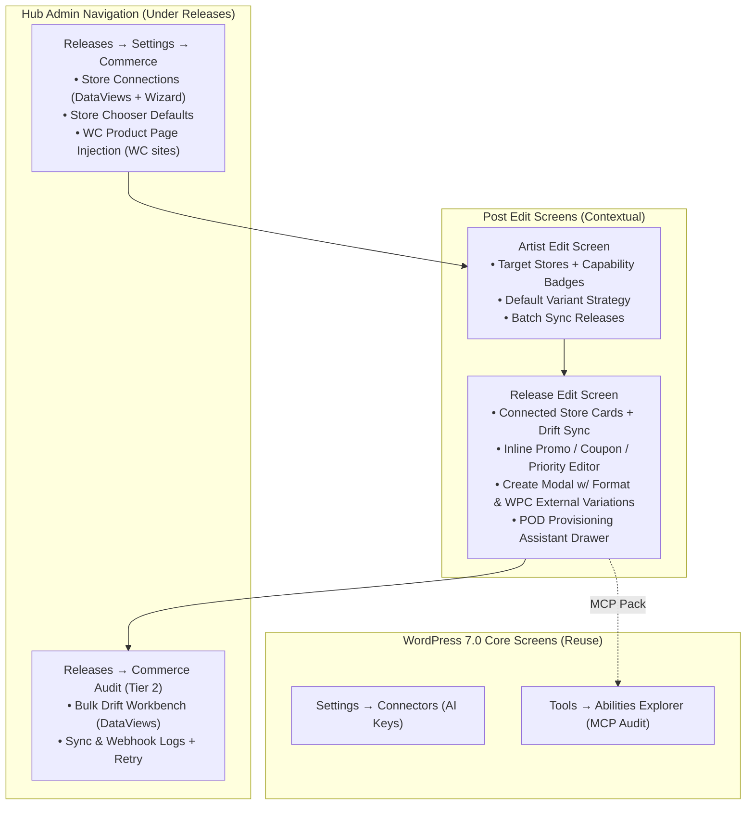

# MDS Commerce Admin Tools — UX & Architecture Feasibility Study

**Topic:** `commerce-admin-tools`  
**Plugin:** `mds-commerce` (`3.0.0`, companion to `mds-release-manager`)  
**Target Audience:** Solo indie artists, boutique label managers, and multi-site network administrators managing WooCommerce, remote stores (Shopify/Wix/Big Cartel), physical media POD (elasticStage/TrepStar/Kunaki), and the Store Chooser block.  
**Date:** 2026-11-26

---

## 1. Context & Gap Analysis

`mds-commerce` (`3.0.0`) now has the backend architecture for multi-platform providers, `CredentialVault`, `RateLimiter`, `ExternalVariationsBridge` (`wpcev_url` / `wpcev_text`), `PodProvisioningProvider`, `StoreChooser` (`mds-commerce/store-chooser`), and WordPress 7.x `Abilities`.

However, the current admin UI still reflects the `mds-woocommerce` 2.x surface:
- **What Exists:** Hub Artist Target Stores + Variant Strategy meta box; Hub Release Store Cards (search/link, drift panel, simple Create Product `<dialog>`); Per-site Single Product Page Injection designer.
- **What Has No Admin UI Yet:**
  1. Adding, testing, and managing **Remote Store Connections** (Shopify, Remote WooCommerce, Wix, Big Cartel) and choosing per-store **Sync Mode** (`Webhook` / `Polling` / `Manual`).
  2. Editing per-release or per-store **Promo Badges, Coupon Codes, Expiration Dates, and Priority Weights** that drive the Store Chooser block.
  3. Managing **Format Variations & WPC External Variations** (`wpcev_url` / `wpcev_text`) inside the Create Product modal and on linked Variable products.
  4. Using the **POD Provisioning Pack** (`GET /mds-commerce/v1/pod-provisioning-pack`) visually via a 1-click Copy Drawer with print-ready artwork QA.
  5. Auditing **Catalog-Wide Drift, Cooldowns, and Sync/Webhook Logs** across dozens or hundreds of releases without opening each Release post one by one.

---

## 2. Admin Tool Inventory & Feasibility Matrix

| Admin Tool / Screen | Location in WP Admin | Direction | Implementation Effort | Longevity & UX Fit | Verdict |
| :--- | :--- | :--- | :--- | :--- | :--- |
| **1. Store Connections & Sync Mode Manager** | `Releases → Settings → Commerce` (Hub/Network) | Read + Configure + Test | **Medium** (3–4 days) | **Very High** — Master-detail `@wordpress/dataviews/wp` table + Connection Wizard Modal with live "Test Connection" & Webhook Health Check | **Build Now (Tier 1)** |
| **2. Release Store Card: Promo/Coupon & External Variations Editor** | Release Edit Screen (inline on Store Cards + Create Modal) | Read + Push | **Medium** (3–4 days) | **Very High** — Zero extra navigation; puts `promo_badge`, `coupon_code`, `priority_weight`, and `wpcev_url`/`wpcev_text` right where admins already link releases | **Build Now (Tier 1)** |
| **3. POD Provisioning Assistant Drawer** | Release Edit Screen (`"POD Prep Pack"` button → `<dialog>` / drawer) | Prep Only | **Low** (1–2 days) | **Very High** — Eliminates manual copy-paste errors for elasticStage, TrepStar, Kunaki, Diggers Factory, and Bandcamp; instant 3000×3000 artwork QA | **Build Now (Tier 1)** |
| **4. Catalog Drift & Sync Activity Workbench** | `Releases → Commerce Audit` (Hub submenu) | Read + Bulk Push | **Medium** (3–5 days) | **High** — `@wordpress/dataviews/wp` bulk table for Drift Status, Cooldowns, and Sync/Webhook error logs with 1-click Retry | **Build Next (Tier 2)** |
| **5. Store Chooser Global Defaults & Live Preview** | `Releases → Settings → Commerce` (sub-tab) | Configure | **Low** (1–2 days) | **High** — Sets site-wide defaults for `[mds-store-chooser]` (grouping, layout, promo boost toggle, stock badge labels) | **Build Next (Tier 2)** |
| **6. Custom LLM API Key / MCP Inspector Screen** | *(Do NOT build)* | N/A | N/A | **Low (Redundant)** — WordPress 7.0 natively provides **Settings → Connectors** and **Tools → Abilities Explorer** | **Skip (Use WP 7.0 Core)** |

---

## 3. Admin Information Architecture

### Key UX Principles for Every Screen
1. **Master-Detail + Wizard Modal (No Sprawling Forms):** Store Connections use a clean list/table with a **"+ Add Store Connection"** modal: Step 1 (Provider & Nickname) → Step 2 (Credentials + `wp-config.php` constant detection + live **"Test Connection"** showing latency/API version/currency) → Step 3 (Sync Mode: Webhook + Health Check / Polling + Interval / Manual Only + Store Promo Defaults).
2. **Non-Blocking Feedback & Section 508:** Every async action (Test Connection, Verify Webhook, Copy Coupon/POD Field, Save Promo, Bulk Drift Check) uses `wp.a11y.speak()` / `aria-live="polite"`, keyboard-trapped native `<dialog>` or `@wordpress/components` `Modal`, and visible `:focus-visible` outlines.
3. **Progressive Disclosure:** Keep advanced settings (Sync Mode intervals, webhook secret rotation, promo expiration UTC timestamps) inside collapsible `
` / `PanelBody` sections so solo indie artists see a clean, uncluttered interface.

---

## 4. Prioritized Rollout & Open Questions

- **Tier 1 (Immediate High-Leverage Admin Tools):**
  1. **Store Connections Manager & Connection Wizard** (supports local WC inspection + remote store CRUD, encrypted secrets via `CredentialVault`, live Test Connection, Sync Mode selector, and store-level promo defaults).
  2. **Release Store Card Promo/Coupon Drawer & Create Modal Format/External Variations Mapper** (wires directly to `ExternalVariationsBridge` and `_mds_commerce_links` so Store Chooser promos and WPC External Variations are 100% editable in the UI).
  3. **POD Provisioning Assistant Drawer** (visualizes `GET /mds-commerce/v1/pod-provisioning-pack` with 1-click Copy buttons and artwork print-readiness check).
- **Tier 2 (Scale & Operations):**
  4. **Catalog Drift & Sync Log Workbench** (`@wordpress/dataviews/wp`).
  5. **Store Chooser Global Defaults** tab.

### Open Questions
1. **Menu Placement:** Should **Store Connections** and **Store Chooser Defaults** live as sub-tabs inside `Releases → Settings → Commerce` (matching how `mds-woocommerce` registered its Settings tab), or should `mds-commerce` add its own top-level submenu item (`Releases → Commerce`)?
2. **Create Modal vs. Dedicated Edit Modal for Variations:** When a Release is already linked to a WooCommerce Variable Product, do you want an **"Edit Variations / POD Links"** button right on the Release Store Card (so you never have to leave the Hub to update an elasticStage or TrepStar URL), or only during initial product creation?
