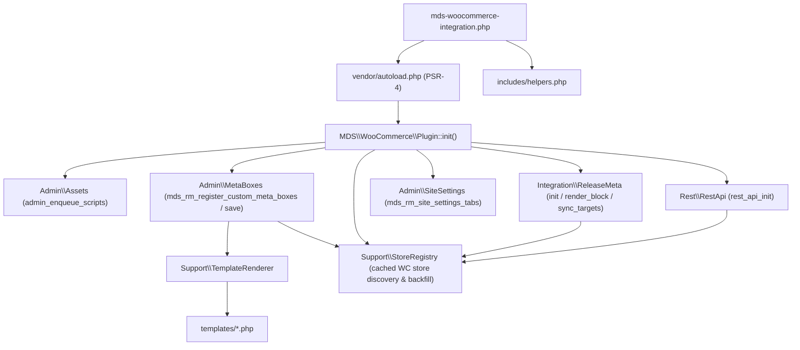

# MDS WooCommerce Integration — Technical Blueprint

## Overview

**MDS WooCommerce Integration** (`mds-woocommerce-integration`) extends **MDS Release Manager** with a **"Seed & Hand Off" (fire-and-forget)** multisite WooCommerce integration:

- Hub admins link existing WooCommerce products on integrated stores or seed new **Draft** products via a compact Create Product modal dialog.
- Product linking, unlinking, and seeding happen immediately via REST endpoints and trigger `MDS_RM_Sync::broadcast_to_spokes()`—there is no `save_post` overwrite handler, so Store Admins retain full ownership of product copy, pricing, and merchandising after creation.
- Single WooCommerce product pages on integrated stores automatically inject `MDS_RM_Release_Meta` output.

- **PHP Root Namespace:** `MDS\WooCommerce\` (Composer PSR-4 -> `src/`)
- **Function / Hook / Handle Prefix:** `mds_wc_`
- **Constant Prefix:** `MDS_WC_`
- **Text Domain:** `mds-woocommerce-integration`
- **Minimum Requirements:** WordPress `7.0+` (Tested up to `7.x`), PHP `8.0+`

---

## Architecture & Directory Structure



```text
mds-woocommerce-integration/
├── mds-woocommerce-integration.php   # Plugin header, constants, Composer autoloader bootstrap
├── composer.json                     # PSR-4 autoloading (MDS\WooCommerce\ -> src/) & WPCS dev deps
├── package.json                      # @wordpress/scripts build, ESLint, Stylelint, Prettier config
├── phpcs.xml.dist                    # WPCS 3.x + PHPCompatibilityWP (8.0-) ruleset
├── includes/
│   └── helpers.php                   # Thin procedural wrappers: mds_wc_is_active(), mds_wc_render_template()
├── src/
│   ├── Plugin.php                    # Service registrar, unified site list, delegated Hub->Spoke permission check
│   ├── Admin/
│   │   ├── Assets.php                # Conditional admin JS/CSS enqueuing (.asset.php + inline seed config)
│   │   ├── MetaBoxes.php             # Artist Target Stores meta box & Release Store Cards / Create Product modal
│   │   └── SiteSettings.php          # Releases -> Settings -> WooCommerce Integration visual blueprint tab
│   ├── Integration/
│   │   └── ReleaseMeta.php           # Dual Block/Classic injection, per-Artist sync targets, SKU->UPC fallback
│   ├── Rest/
│   │   └── RestApi.php               # REST endpoints (/settings, /stores/refresh, /artists/{id}/sync-releases, /search, /link, /taxonomies, /generate)
│   ├── Support/
│   │   ├── StoreRegistry.php         # Cached WC store discovery, per-Artist/Release lookup memoization, one-time backfill
│   │   └── TemplateRenderer.php      # Safe template resolution with theme override support
│   └── admin/
│       ├── admin.css                 # Store Cards, Artist stores meta box, accessible combobox, and <dialog> modal styles
│       ├── artist-stores.js          # Artist meta box store refresh + batched Release sync loop
│       ├── site-settings.js          # Visual Product Page Blueprint drag-and-drop & live preview
│       └── product-linker.js         # Zero-CDN Store Cards, live search combobox, and Create Product modal
├── templates/                        # Overridable via theme/mds-woocommerce-integration/*.php
└── tests/
    └── store-registry.php            # Standalone PHP test for StoreRegistry, per-Artist sync, security, and backfill
```

---

## REST API Endpoints

Primary namespace: `mds-wc/v1` (legacy `mds-woo/v1` alias routes remain registered for backward compatibility).

| Method | Route | Permission / Access | Handler | Purpose |
| :--- | :--- | :--- | :--- | :--- |
| `POST` | `/settings` | `manage_options` | `RestApi::save_site_settings()` | Validates and stores per-site single-product injection settings (`mds_wc_product_injection`). |
| `POST` | `/stores/refresh` | `edit_posts` | `RestApi::refresh_stores()` | Flushes `mds_wc_network_stores` transient and returns auto-detected WooCommerce stores. |
| `POST` | `/artists/{id}/sync-releases` | `edit_post` (Hub only) | `RestApi::sync_artist_releases()` | Batched sync (10 releases/request) of an Artist and their Releases to assigned stores. |
| `GET` | `/search` | `edit_posts` + `Plugin::user_can_manage_spoke_product()` | `RestApi::search_products()` | Live search of WooCommerce products (`publish`, `draft`, `pending`, `private`) on an integrated store. |
| `POST` | `/link` | `edit_posts` + `Plugin::user_can_manage_spoke_product()` | `RestApi::link_product()` | Links an existing spoke product to `_mds_linked_products` and triggers `MDS_RM_Sync::broadcast_to_spokes()`. |
| `DELETE` | `/link` | `edit_posts` + `Plugin::user_can_manage_spoke_product()` | `RestApi::unlink_product()` | Removes a store's link from `_mds_linked_products` and broadcasts to spokes. |
| `GET` | `/taxonomies` | `edit_posts` + `Plugin::user_can_manage_spoke_product()` | `RestApi::get_taxonomies()` | Fetches live `product_cat` and `product_tag` terms from a spoke store for the Create Product modal. |
| `POST` | `/generate` | `edit_posts` + `Plugin::user_can_manage_spoke_product()` | `RestApi::generate_product()` | Seeds a new WooCommerce product (`WC_Product_Simple`, defaulting to `draft`) with title, description, short description, SKU, price, categories, tags, and virtual featured image; links and broadcasts to spokes. |

---

## Hook & Integration Contracts

### Custom Hooks Provided
- `apply_filters( 'mds_wc_user_can_manage_spoke_product', bool $can_manage, int $release_id, int $store_id )` — Filters delegated Hub-to-Spoke product link/seed permission for Hub Release editors without spoke-site accounts.
- `apply_filters( 'mds_wc_injectable_blocks', array $blocks )` — Filters the auto-discovered `mds-release-manager` category blocks (Core + Bandcamp + extensions + Custom Shortcode) available in the **Releases -> Settings -> WooCommerce Integration** block picker.

### Consumed `mds-release-manager` Hooks
- `mds_rm_register_custom_meta_boxes` (action) — Registers `mds_wc_artist_stores` on Hub `artist` posts and `mds_wc_settings` on Hub `release` posts.
- `mds_rm_save_custom_meta` (action) — Persists `_mds_wc_target_stores` on Hub `artist` posts and requests cache purges for changed stores.
- `mds_rm_sync_target_sites` (filter, 3 args) — Scopes Artist and Release broadcasts strictly to the Artist's assigned `_mds_wc_target_stores` via `StoreRegistry` (memoized per request).
- `mds_rm_after_shadow_meta_sync` (action) — Maps `_mds_linked_products[$site_id]` to `_mds_local_product_id` on shadow posts.
- `mds_rm_release_meta_context_upc` (filter) — Uses numeric WooCommerce product SKU as fallback UPC.
- `mds_rm_after_buy_now_field` (action) — Renders `#mds_use_linked_product_btn` next to the Multi-Format Buy Now repeater (`#mds_buy_now_links_wrapper`); clicking appends a row using the `all` `release_media_format` term (auto-seeded on the Hub with icon `fas fa-boxes-stacked`), the WooCommerce store name, and the linked published product permalink.
- `mds_rm_purge_cache` (action, invoked via `Plugin::request_cache_purge()`) — Requests coalesced, multisite-aware cache purges through `MDS_RM_Cache` on product injection settings save (`woocommerce_settings`), network store changes (`woocommerce_network_settings` per changed `blog_id`), and product link/unlink/generate actions (`woocommerce_link`, `woocommerce_unlink`, `woocommerce_generate` targeting `$store_id`).
- `mds_rm_after_cache_purge` (action) — Clears WooCommerce product transients (`wc_delete_product_transients()`) after `manual` or `woocommerce_settings` cache purges.

### Consumed WooCommerce Hooks
- `woocommerce_single_product_summary` (priorities `5`, `15`, `25`, `45`) and `woocommerce_after_single_product_summary` (priority `10`), controlled by the `mds_rm_woo_injection` theme mod.

---

## Persisted Data Schema (Backward-Compatible Keys)

| Key | Scope | Description |
| :--- | :--- | :--- |
| `_mds_wc_target_stores` | Post Meta (`artist`) | Array of assigned active WooCommerce store blog IDs (replaces network-wide store selection). |
| `mds_wc_network_stores` | Network Transient (`wp_sitemeta`) | 1-hour cache of auto-detected active WooCommerce sites (`site_id`, `site_name`, `site_url`). |
| `mds_wc_artist_stores_migrated` | Site Option (Hub `wp_options`) | Marker (`'1'`) set once the one-time legacy backfill from `mds_rm_wc_integrated_sites` completes. |
| `mds_rm_wc_integrated_sites` | Network Site Option (`wp_sitemeta`) | Legacy network store ID list (retained non-destructively for one-time Artist backfill). |
| `mds_rm_woo_sites` | Network Site Option / Option | Legacy site ID list merged by `Plugin::get_integrated_sites()`. |
| `mds_rm_woo_injection` | Theme Mod | Legacy Release Meta placement fallback synced with `mds_wc_product_injection[release_meta_placement]`. |
| `mds_wc_product_injection` | Site Option (`wp_options`) | Per-site single-product injection settings (`release_meta_placement`, `release_links_placement`, `hide_buy_now`, `custom_placement`, `custom_content`) managed in **Releases -> Settings -> WooCommerce Integration** for both Block Themes (`render_block`) and Classic WooCommerce themes. |
| `_mds_linked_products` | Post Meta (`release`) | Associative array `[ store_id => product_id ]` mapping a release to linked WooCommerce products. |
| `_mds_local_product_id` | Post Meta (`release` / shadow) | Local WooCommerce product ID for the current site. |
| `_mds_wc_seeded_from_release`, `_mds_wc_seeded_by`, `_mds_wc_seeded_gmt` | Post Meta (`product` on spoke) | Audit metadata recording which Hub release and user seeded the product. |
