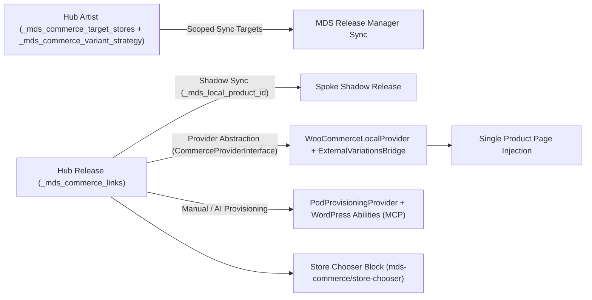

# MDS Commerce — Technical Blueprint

**Plugin Slug:** `mds-commerce` (in-place evolution of `mds-woocommerce`)  
**Version:** `3.0.0` · **Requires:** `mds-release-manager` (`MDS_RM_API_VERSION = 2.0.0+`)  
**PHP Root Namespace:** `MDS\Commerce\` (Composer PSR-4 → `src/`)  
**Compatibility:** WordPress `7.0+` (Tested up to `7.x`) · PHP `8.0+` · Multisite Hub-and-Spoke · WooCommerce (Classic & Block Themes) · WPC External Variations (`1.1.1+`)

---

## 1. High-Level Architecture



- **Bootstrap (`mds-commerce.php`):** Loads Composer PSR-4 autoloader (`vendor/autoload.php`), `includes/helpers.php` (`mds_cm_*` + `mds_wc_*` shims), `includes/legacy-class-aliases.php` (lazy `MDS\WooCommerce\*` aliases), and initializes `MDS\Commerce\Plugin::init()` on `mds_rm_loaded`.
- **Provider Architecture:** `CommerceProviderInterface`, `EmbeddableProviderInterface`, `ExportPrepProviderInterface`, `ProviderManager` (`mds_cm_register_providers` filter), `StoreKey` (`{provider}:{id}`), `StoreConnection`, `NormalizedProduct`, `DriftReport`, `CredentialVault` (libsodium + OpenSSL AES-256-GCM + `wp-config.php` constants), and `RateLimiter`.
- **Zero-Loss Migration (`Sync\UpgradeRoutine`):** Idempotently migrates `_mds_wc_target_stores` → `_mds_commerce_target_stores`, `_mds_linked_products` → `_mds_commerce_links`, and `mds_wc_product_injection` → `mds_cm_wc_product_injection`, while keeping `_mds_local_product_id` untouched on Spoke shadow releases.
- **Physical POD & External Variations (`Providers\WooCommerceLocal\ExternalVariationsBridge`):** Auto-detects `wpc-external-variations` (`WPCleverWpcev` / `WPCEV_VERSION`) per store and reads/writes `wpcev_url` and `wpcev_text` on `product_variation` posts for elasticStage, TrepStar, Kunaki, Diggers Factory, and Qrates.
- **Store Chooser (`Blocks\StoreChooser`):** Gutenberg block `mds-commerce/store-chooser` (API v3) and shortcode `[mds-store-chooser]`, grouped by Media Format by default with coupon/promo auto-boost (`promo_badge`, 1-click copy `coupon_code`, `promo_expires_gmt`, `priority_weight`).
- **WordPress 7.x Abilities (`Api\Abilities`):** Exposes read-only `mds-commerce/list-stores`, `mds-commerce/get-release-links`, and `mds-commerce/get-pod-provisioning-pack` with `meta.mcp.public = true`.

---

## 2. Directory Structure

```text
mds-commerce/
├── mds-commerce.php                    # Bootstrap, MDS_CM_* (+ legacy MDS_WC_*) constants
├── uninstall.php                       # Cleans mds_cm_* & legacy mds_wc_* options/transients
├── composer.json                       # PSR-4 (MDS\Commerce\ -> src/) + WPCS 3 / PHPCompatibilityWP
├── package.json                        # @wordpress/scripts build/lint scripts
├── phpcs.xml.dist                      # WPCS ruleset (text_domain: mds-commerce)
├── wpml-config.xml                     # WPML/Polylang admin-texts & custom-fields config
├── blocks/store-chooser/               # mds-commerce/store-chooser (block.json, index.js, view.js, style.css)
├── includes/
│   ├── helpers.php                     # mds_cm_* helpers + mds_wc_* backward-compatible wrappers
│   └── legacy-class-aliases.php        # Lazy class_alias() shims for MDS\WooCommerce\*
├── src/
│   ├── Config.php                      # Option/meta/transient keys, REST namespaces, strategies
│   ├── Plugin.php                      # Service wiring, UpgradeRoutine, GitHub updater
│   ├── Admin/                          # Assets, MetaBoxes (Variant Strategy + Capabilities), SiteSettings
│   ├── Api/                            # Abilities (WordPress 7.x Abilities API / MCP)
│   ├── Blocks/                         # StoreChooser block & [mds-store-chooser] shortcode
│   ├── Contracts/                      # CommerceProviderInterface, EmbeddableProviderInterface, ExportPrepProviderInterface
│   ├── Integration/                    # ReleaseMeta (Context resolution, Sync scoping, WC injection)
│   ├── Model/                          # StoreKey, StoreConnection, NormalizedProduct, DriftReport
│   ├── Providers/
│   │   ├── WooCommerceLocal/           # WooCommerceLocalProvider, ExternalVariationsBridge
│   │   └── Prep/                       # PodProvisioningProvider (elasticStage, TrepStar, Kunaki, Diggers Factory, Qrates)
│   ├── Registry/                       # ProviderManager
│   ├── Rest/                           # RestApi (mds-commerce/v1 + legacy mds-wc/v1 & mds-woo/v1)
│   ├── Security/                       # CredentialVault (libsodium + OpenSSL + wp-config constants)
│   └── Support/                        # ProductDrift, StoreRegistry, TemplateRenderer
│   └── Sync/                           # RateLimiter, UpgradeRoutine
├── templates/                          # Overridable admin view templates
└── tests/                              # store-registry.php, commerce-core.php
```

---

## 3. REST API Endpoints (`mds-commerce/v1`, legacy aliases `mds-wc/v1`, `mds-woo/v1`)

| Method & Route | Permission | Purpose |
| :--- | :--- | :--- |
| `GET /search` | `edit_posts` + store access | Search published/draft products on an assigned store |
| `POST /link` | `edit_posts` + store access | Link an existing product to a Release, broadcast link, return product + drift |
| `DELETE /link` | `edit_posts` + store/legacy access | Unlink a product from a Release and broadcast |
| `POST /generate` | `edit_posts` + store access | Seed a new Draft (or Published) product with virtual cover art |
| `GET /taxonomies` | `edit_posts` + store access | Fetch `product_cat` and `product_tag` terms for the Create Product modal |
| `POST /sync-product` | `edit_posts` + store/legacy access | Selectively push approved drift fields (`upc`, `sku`, `thumbnail`, `title`) |
| `GET /pod-provisioning-pack` | `edit_post` | Return verified Release metadata, tracklist, and artwork specs for POD portals |
| `POST /settings` | `manage_options` | Save per-site Single Product Page Injection settings |
| `POST /stores/refresh` | Hub + `edit_posts` | Invalidate and rebuild the network store cache |
| `POST /artists/{id}/sync-releases` | Hub + `edit_post` | Cursor-paged (10/batch) Artist + Release broadcast to assigned stores |
