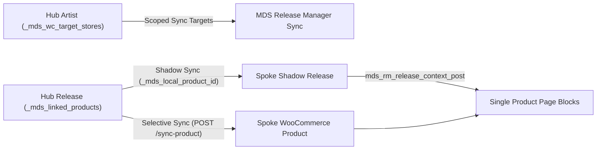

# MDS WooCommerce Integration — Technical Blueprint

**Plugin Slug:** `mds-woocommerce`  
**Version:** `2.0.0` · **Requires:** `mds-release-manager` (`MDS_RM_API_VERSION = 2.0.0+`)  
**PHP Root Namespace:** `MDS\WooCommerce\` (Composer PSR-4 → `src/`)  
**Compatibility:** WordPress `7.0+` (Tested up to `7.x`) · PHP `8.0+` · WooCommerce (Classic & Block Themes)

---

## 1. High-Level Architecture



- **Bootstrap (`mds-woocommerce.php`):** Loads Composer PSR-4 autoloader (`vendor/autoload.php`), `includes/helpers.php`, and initializes `MDS\WooCommerce\Plugin::init()` on `mds_rm_loaded`.
- **Per-Artist Scoped Targeting (`StoreRegistry`):** Auto-detects active WooCommerce sites across the multisite network (zero blog switches when WooCommerce is network-activated), caches the registry in `mds_wc_network_stores` with a `try/finally` stampede lock and `mds_wc_network_stores_fallback` stale-while-revalidate option, and scopes `mds_rm_sync_target_sites` per Artist (`_mds_wc_target_stores`).
- **Direct Context Resolution (`Integration\ReleaseMeta`):** Hooks `mds_rm_release_context_post` to resolve linked WooCommerce products directly to their local shadow `WP_Post` release via `_mds_local_product_id` (memoized per request, immune to UPC/SKU changes), with `mds_rm_release_meta_context_upc` falling back to `_global_unique_id` (GTIN) only for unlinked products.
- **Drift Detection & Selective Sync (`Support\ProductDrift`):** Compares Hub Releases against linked WooCommerce products (UPC/GTIN, Cover Art via `_mds_hub_media_id`, and normalized Title) with zero extra blog switches on render, and applies only admin-approved fields via `POST /mds-wc/v1/sync-product` with server-side custom-SKU protection, duplicate-SKU checks, and `wc_product_meta_lookup` updates.

---

## 2. Directory Structure

```text
mds-woocommerce/
├── mds-woocommerce.php               # Bootstrap, constants (MDS_WC_*), mds_rm_loaded hook
├── uninstall.php                     # Cleans plugin options & network transients across all sites
├── composer.json                     # PSR-4 (MDS\WooCommerce\ -> src/) + WPCS 3 / PHPCompatibilityWP
├── package.json                      # @wordpress/scripts build/lint scripts
├── phpcs.xml.dist                    # WordPress Coding Standards ruleset
├── wpml-config.xml                   # WPML/Polylang custom-field & option config
├── README.md                         # Developer documentation
├── readme.txt                        # WordPress.org directory readme
├── USER-MANUAL.md                    # End-user & site-admin manual
├── changelog.md                      # Append-only Keep a Changelog history
├── includes/
│   └── helpers.php                   # Template helper & backward-compatible global wrappers
├── src/
│   ├── Config.php                    # Option/meta/transient constants
│   ├── Plugin.php                    # Central hook orchestrator, textdomain, permissions, cache purge
│   ├── Admin/
│   │   ├── Assets.php                # Conditional Hub & WC settings asset enqueueing
│   │   ├── MetaBoxes.php             # Hub Release Store Cards & Artist Target Stores meta boxes
│   │   ├── SiteSettings.php          # Per-site Single Product Page Injection designer tab
│   │   ├── admin.css                 # Admin UI styles (Store Cards, Drift Panel, Injection Designer)
│   │   ├── artist-stores.js          # Artist Target Stores refresh & batched sync UI
│   │   ├── product-linker.js         # Accessible Store Cards, combobox search, Create modal, Drift sync
│   │   └── site-settings.js          # Drag-and-drop Single Product Injection designer
│   ├── Integration/
│   │   └── ReleaseMeta.php           # Context resolution, sync target scoping, Classic & Block injection
│   ├── Rest/
│   │   └── RestApi.php               # mds-wc/v1 (and legacy mds-woo/v1) REST endpoints
│   └── Support/
│       ├── ProductDrift.php          # Release-to-Product drift detection & selective sync engine
│       ├── StoreRegistry.php         # Cached multisite WC store discovery & Artist target store registry
│       └── TemplateRenderer.php      # Theme-overridable PHP template renderer
├── templates/                        # Overridable admin view templates
└── tests/
    └── store-registry.php            # Standalone PHP unit tests
```

---

## 3. REST API Endpoints (`mds-wc/v1`, legacy alias `mds-woo/v1`)

| Method & Route | Permission | Purpose |
| :--- | :--- | :--- |
| `GET /search` | `edit_posts` + store access | Search published/draft products on an assigned WooCommerce store |
| `POST /link` | `edit_posts` + store access | Link an existing product to a Release, broadcast link, return product + drift |
| `DELETE /link` | `edit_posts` + store/legacy access | Unlink a product from a Release and broadcast |
| `POST /generate` | `edit_posts` + store access | Seed a new Draft (or Published) WooCommerce product with virtual cover art |
| `GET /taxonomies` | `edit_posts` + store access | Fetch `product_cat` and `product_tag` terms for the Create Product modal |
| `POST /sync-product` | `edit_posts` + store/legacy access | Selectively push approved drift fields (`upc`, `sku`, `thumbnail`, `title`) |
| `POST /settings` | `manage_options` | Save per-site Single Product Page Injection settings |
| `POST /stores/refresh` | Hub + `edit_posts` | Invalidate and rebuild the network WooCommerce store cache |
| `POST /artists/{id}/sync-releases` | Hub + `edit_post` | Cursor-paged (10/batch) Artist + Release broadcast to assigned stores |

---

## 4. Storage Schema & Uninstall Parity

- **Site Options:** `mds_wc_product_injection` (per-site block injection items), `mds_wc_artist_stores_migrated` (one-time backfill flag).
- **Network Site Options / Transients:** `mds_wc_network_stores` (transient), `mds_wc_network_stores_lock` (transient), `mds_wc_network_stores_fallback` (site option).
- **Post Meta:** `_mds_wc_target_stores` (Hub Artist), `_mds_linked_products` (Hub Release), `_mds_local_product_id` (Spoke shadow Release, protected via `mds_rm_spoke_protected_meta_keys`), `_mds_wc_seeded_from_release` / `_mds_wc_seeded_by` / `_mds_wc_seeded_gmt` (Product).
- **Uninstall (`uninstall.php`):** Removes all plugin-owned options and network transients across single-site and all Multisite blogs inside `try/finally`, while preserving WooCommerce products and linked release post meta.
