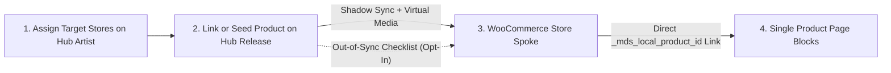

# MDS WooCommerce Integration — User Manual

**Version:** `2.0.0`  
**Requirements:** WordPress `7.0+` · PHP `8.0+` · **MDS Release Manager `2.0.0+`** · WooCommerce

---

## Table of Contents

1. [Overview](#overview)
2. [Installation & Multisite Setup](#installation--multisite-setup)
3. [Core Workflows](#core-workflows)
4. [Settings Reference (Single Product Page Injection)](#settings-reference-single-product-page-injection)
5. [Troubleshooting, Caching & FAQ](#troubleshooting-caching--faq)
6. [Uninstalling & Data Cleanup](#uninstalling--data-cleanup)

---

## Overview

**MDS WooCommerce Integration** bridges **MDS Release Manager** and **WooCommerce** across single-site installs and WordPress Multisite networks. Catalog managers author Releases and Artists on the Hub site, assign which WooCommerce store(s) sell each Artist's music, link or seed Draft products, and inject **Release Meta**, **Release Links**, **Release Player**, and companion MDS blocks directly onto Single Product pages—without ever auto-overwriting a Store Admin's product edits.

---

## Installation & Multisite Setup

1. Ensure **MDS Release Manager (`2.0.0+`)** is installed and active (Network Activated on Multisite).
2. Upload and activate **MDS WooCommerce Integration (`mds-woocommerce`)** via **Plugins → Add New → Upload Plugin** (or **Network Activate** on Multisite).
3. **No global network store setup is required:** active WooCommerce stores across your network are discovered automatically.
4. On any **Artist** in the Hub, assign one or more **WooCommerce Target Stores** (existing Artists from earlier versions are automatically backfilled).

---

## Core Workflows

### 1. Assigning WooCommerce Target Stores to an Artist
1. On your Hub site, open an Artist under **Releases → Artists**.
2. Scroll to the **WooCommerce Target Stores** meta box.
3. Check the WooCommerce store(s) where this Artist's releases should be synced and sold.
   - Click **Refresh Stores** if you recently activated WooCommerce on a new site in your network.
4. Click **Update** to save the Artist.
5. Click **Sync Artist Releases** to broadcast this Artist and all of their existing Releases to the selected stores in batches.

> **Screenshot:** *Hub Artist edit screen showing the WooCommerce Target Stores meta box and Sync Artist Releases button.*

### 2. Linking an Existing Product or Creating a New Draft Product
1. On your Hub site, open a Release under **Releases → All Releases** (save a draft first if it is brand new).
2. Scroll to the **WooCommerce Integration** meta box. Each store assigned to the Release's Artist appears as a **Store Card**.
3. **To link an existing product:** Type in the **Link Existing Product** search box to find published or draft products on that store and select one. The link is saved and broadcast immediately.
4. **To create a new product:** Click **Create Product** to open the compact modal pre-filled with the Release's Title, Short Description, Description, UPC/EAN (saved as both GTIN and SKU), and Cover Art (linked via zero-duplication Virtual Media). Adjust Price, Status (**Draft** by default), Categories, and Tags, then click **Create & Link Product**.
5. Click **Use Linked Product URL** in the Release's Commerce section to populate the **Buy Now** repeater with the published store product URL(s).

> **Screenshot:** *Hub Release edit screen showing a Linked Store Card with View in Store, Edit in Store, Change Link, and Unlink actions.*

### 3. Handling Release-to-Product Drift ("Out of Sync")
Editing a Release on the Hub **never** silently overwrites changes a Store Admin made to a WooCommerce product. Instead, when you update a linked Release, the Store Card compares three key fields:
- **UPC / EAN (GTIN):** Compares the Release's `upc_ean` against WooCommerce's **GTIN, UPC, EAN, or ISBN** field.
  - If the product's **SKU** still matches the previous UPC, an optional **Also update SKU** checkbox appears. Custom SKUs (such as `VINYL-LP-001`) are automatically protected and never overwritten.
- **Cover Art:** Detects when the Release's featured image differs from the product's featured image (or if the product has no image or a custom store-uploaded image).
- **Product Title:** Detects genuine title changes (ignoring minor typographic differences like `...` vs `…`).

When any difference is detected:
1. The Store Card displays an amber **Out of sync** badge and a **Product differs from this Release** checklist showing each old → new value.
2. Check only the fields you want to push to the store product and click **Update Product**.
3. The store product updates immediately and the badge clears.

> **Screenshot:** *Store Card showing the Out of sync badge, per-field diff checklist, optional SKU checkbox, and Update Product button.*

---

## Settings Reference (Single Product Page Injection)

On any site where **WooCommerce is active**, go to **Releases → Settings → WooCommerce Integration** to configure which MDS blocks are automatically injected onto Single Product pages (works with both Block Themes and Classic WooCommerce themes):

1. **Add a Block:** Choose any registered MDS block (**Release Meta**, **Release Links**, **Release Player**, companion Bandcamp/extension blocks, or **Custom Shortcode / Block Markup**) and click **+ Add Block**.
2. **Position Blocks:** Drag and drop blocks between Single Product Page slots (Above/Below Title, Below Price, Below Short Description, Below Add to Cart, Below Product Gallery, Before/After Product Details) or use the accessible Up/Down steppers.
3. **Default Placements (Fresh Activation):**
   - **Release Meta:** Below Product Title
   - **Release Links:** Below Short Description / Excerpt (*Hide Buy Now icon on product pages* enabled by default)
   - **Release Player:** Below Short Description / Excerpt
4. Click **Save Settings** (automatically purges configured page caches).

> **Screenshot:** *Releases → Settings → WooCommerce Integration showing the Single Product Page Injection designer and live preview.*

---

## Troubleshooting, Caching & FAQ

**Why don't I see the WooCommerce Integration tab under Releases → Settings?**  
The tab is intentionally shown only on sites where **WooCommerce** is actively installed and enabled. On Multisite, open **Releases → Settings** on your **Store** site rather than the Hub site (unless WooCommerce is also active on the Hub).

**Why aren't Release Meta, Release Links, or Release Player showing on a Single Product page?**  
1. Confirm the Release is linked to that product on the Hub Release's **WooCommerce Integration** Store Card (and that the Artist is assigned to that store).  
2. If you linked the product before syncing the Artist, click **Sync Artist Releases** on the Artist edit screen so the shadow Release exists on the store site.  
3. If the product is *not* explicitly linked in MDS, make sure WooCommerce's **GTIN, UPC, EAN, or ISBN** field matches the Release's UPC/EAN (numeric SKU matching is intentionally disabled).

**Will changing a Release's UPC break my linked product page?**  
No. Explicitly linked products resolve directly by their `_mds_local_product_id` link, completely independent of UPC or SKU. You can update the product's GTIN/SKU whenever you're ready via the Store Card's **Out of sync** panel.

**My store uses a caching plugin — do I need to flush caches manually?**  
No. Linking, unlinking, creating, drift-syncing, and saving injection settings all trigger MDS Release Manager's coalesced Cache Manager automatically.

---

## Uninstalling & Data Cleanup

- **Deactivating** the plugin pauses Single Product Page injection and Hub Store Cards without deleting any data.
- **Deleting** the plugin via **Plugins → Delete** removes all plugin-owned options (`mds_wc_product_injection`, `mds_wc_artist_stores_migrated`) and network store caches (`mds_wc_network_stores*`) across single-site and all Multisite blogs, while **preserving all WooCommerce products and Release post metadata**.
